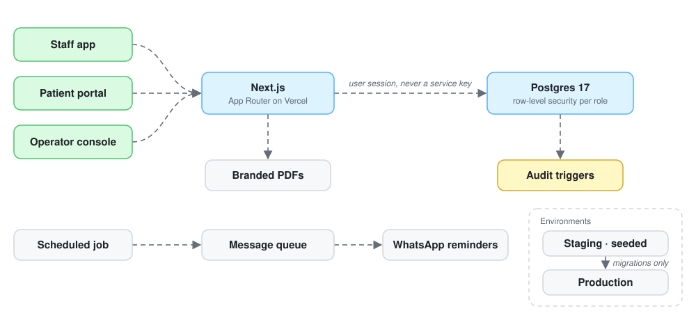
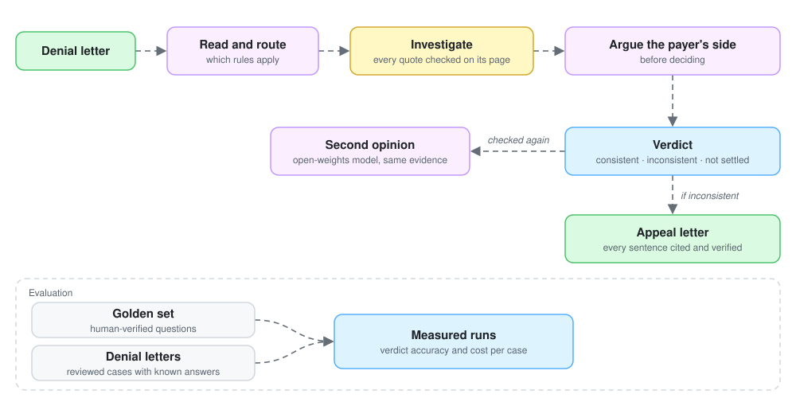
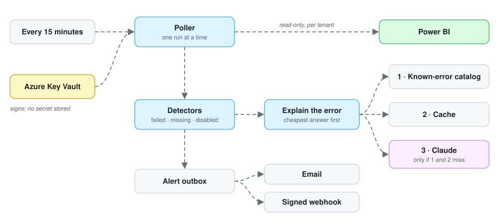
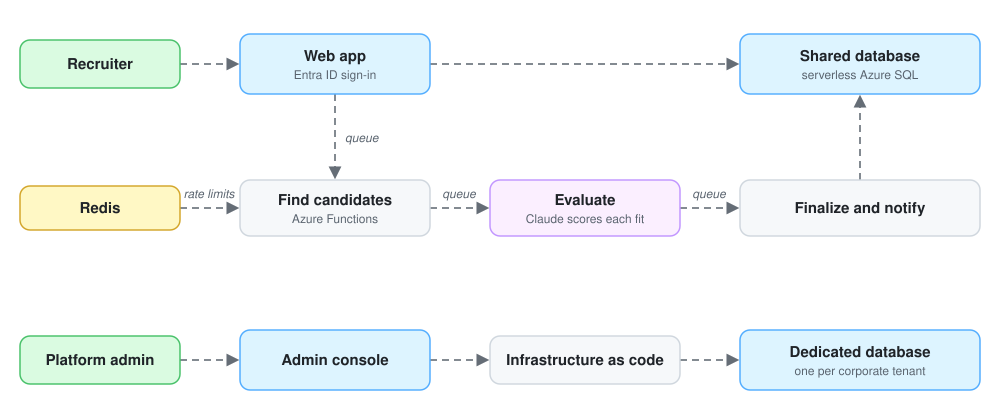
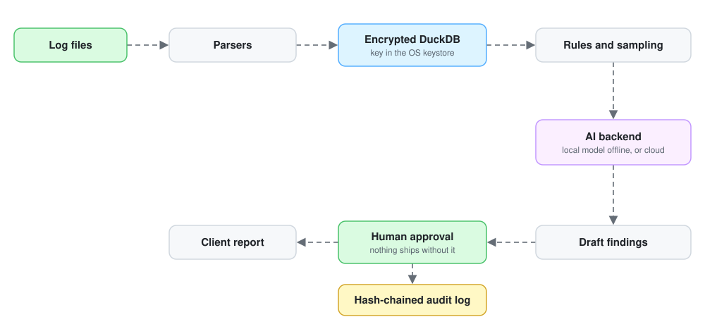

  

**AI engineer. I build multi-tenant products end to end, and I use AI agents to assist my development without lowering the bar.**

Open to full-time roles and selected freelance work

  

Also in daily use: Claude (API and Claude Code), Codex, Playwright, pgTAP, mutation testing, Stripe, DuckDB, Ollama.

---

## What I'm working on now

*Updated December 2026.*

- **MiConsultorio**: clinic management for medical and dental practices in Venezuela. In production, pre-launch.
- **[pau-skills](https://github.com/paureis/pau-skills)**: the Claude Code skills, hooks and scripts I use every day, packaged as a plugin marketplace so others can reap the benefits as well.
- **[cloudpin](https://github.com/paureis/cloudpin)**: a seatbelt for cloud CLIs. It pins each project to its cloud accounts and stops any command, mine or an AI agent's, that would run on the wrong one. On npm and past 1.0.
- **PauPortfolio**: my portfolio site, a closer look at my work and what I do off the clock. *Coming soon.*

---

## How I work

I build with AI agents every day, and I hold them to the same bar as any engineer: a change is done when it is proven, not when it looks right. I talk to one orchestrator session. It plans, hands each piece of work to a subagent sized for the job, and checks what comes back before it counts.

  

<b>The six steps in plain words</b>

1. **Decide** (`brainstorm`, `grill-me`): before any code, I get questioned until every open choice has an answer.
2. **Plan** (`to-prd`, `to-issues`): the decision becomes a short spec, cut into slices that can each be built and checked alone.
3. **Build** (`tdd`, `parallel-worktrees`): agents write the test first, then the code, each slice on its own branch so none collide.
4. **Prove** (`evaluator`, `mutation-test`): a fresh agent tries to break the work, and tests are broken on purpose to show they can fail.
5. **Ship** (`review-triage`, `safe-merge`): only the review findings that matter get fixed, in one round, then the reviewed commit is merged.
6. **Learn** (`retrospective`, `rule-to-hook`): every correction becomes a rule, and a rule that keeps getting broken becomes an automatic check.

- **No agent grades its own work.** A fresh agent that did not build the change tries to break it, claim by claim, and mutation tests break the code on purpose to prove the tests notice.
- **A rule that keeps getting broken becomes code.** Hooks run on every step. They block leaked secrets, destructive commands, tests edited to pass, cloud commands aimed at the wrong account, and any "done" that no check backs up.
- **It's all public.** The skills and hooks are in [pau-skills](https://github.com/paureis/pau-skills) and the wrong-account check is [cloudpin](https://github.com/paureis/cloudpin), each with its own tests.

The steps above are the full method. The wall below is what I actually reach for: the lit skills are the ones I use most, and every other skill in the repo comes in when the situation calls for it. Not every task needs all of them.

  

---

## Featured work

Most of what I build lives in private repositories, so here is what's inside them. The diagrams share one colour key: green is where things start or end (a person, a document, an outside service), blue is the core of the system, purple is an AI model, and yellow is a safeguard.

### MiConsultorio · clinic management

Scheduling, patient records with clinical history and odontogram, billing in two currencies, inventory, memberships, WhatsApp reminders, a patient portal and an audit trail, for small practices that today run on paper and chat messages. I am the sole engineer; a partner leads the commercial side.

  

*In plain terms: staff, patients and the clinic's operator each get their own app, and the database itself decides who can see which record, so a mistake in the app cannot expose a patient's file.*

**Stack:** Next.js 16 (App Router) · TypeScript · Tailwind v4 · Supabase (Postgres 17, Auth, Storage) · Vercel · Vitest · Playwright

<b>Engineering notes</b>

- **Access rules live in the database.** Row-level security decides which rows each role sees, the server decides modules and amounts, and the client only renders. Every new rule ships with a test that signs in as each role.
- **Two-factor is enforced in the database too**, not only in the UI, with a guided setup that always ends in backup codes.
- **About 720 end-to-end tests run from a freshly seeded database** before every release to production and nightly, next to about 3,900 unit and 800 row-level-security tests. A flaky test is treated as a defect.
- **Staging and production are separate projects**; migrations are additive and reach staging before a merge.

### Recourse · AI appeals for coverage denials

Turns a coverage denial letter into an investigated verdict and a cited appeal letter, over 64 public Florida Medicaid, Medicare and HIPAA documents. Every quote is checked against its page, anything unsupported is struck out on screen, and when the documents don't settle a case it says so. Built on Muse Spark for the Meta Global AI Developer Hackathon. [Live demo](https://recourse-murex.vercel.app) · [Video](https://youtube.com/watch?v=GfoXbH7f9oU) · [Code](https://github.com/paureis/recourse)

  

*In plain terms: it reads a denial letter, looks up the actual rules, and drafts an appeal in which every quote is checked against its source. Anything it can't back up is crossed out instead of left in.*

<b>Engineering notes</b>

- **Measured against known answers.** Across three full runs of 30 reviewed denial letters, the verdict was right on 25 to 28 of 30, every one of 224 appeal-letter claims cited a quote that passed the checker, and a case cost about $0.10. A 160-row human-verified golden set checks the answers behind them.
- **Quotes are checked, not trusted.** Most of a quote's wording must match its page before it counts; a quote that fails is struck out on screen rather than quietly removed.
- **It argues the other side first.** Before the verdict it makes the payer's case as well as the rules allow, and an open-weights model gives a second opinion on the same evidence.
- **"Not settled" is an answer.** When the documents don't decide a case, it says so instead of guessing. About 580 tests.

### RefreshRadar · Power BI refresh monitoring

Catches failed, missed and silently disabled dataset refreshes, explains the error in plain language and alerts by email or webhook. Shipped to production as a self-serve product with Stripe subscriptions. It is on hold while my time goes to MiConsultorio, with the code and data kept ready to redeploy.

  

*In plain terms: it checks a company's Power BI reports every 15 minutes, notices when the data stopped updating, explains why in plain language and tells the team. It calls an AI model only when a cheaper answer isn't available.*

**Stack:** Next.js 16 · TypeScript · Supabase Postgres (forced RLS) · Microsoft Entra ID · Azure Key Vault · Stripe · Resend · Vercel Cron · Claude through Vercel AI Gateway

<b>Engineering notes</b>

- **The LLM is the last resort.** A deterministic catalog answers first, then a cache; a model is called only when both miss, behind an interface so the whole suite runs with no network and no key.
- **No client secret anywhere.** Tenants are reached with a certificate assertion whose private key never leaves Key Vault.
- **The architecture document cannot go stale.** A test fails CI if the architecture manifest and the code disagree, in either direction.
- **About 1,700 unit, 300 integration and 129 database tests**, plus eight custom static gates (for example: privileged database imports only from one layer; the cron schedule in config must equal the constant in code).

### Talent Scout Pro · multi-tenant recruiting platform

A multi-tenant recruiting platform that ran in production with healthcare clients. I am the founder and sole engineer. Paused in November 2026 while it moves to a single-organization deployment. Details of the product are deliberately brief here; the engineering side is definitely not.

  

*In plain terms: a recruiter starts a search, and a pipeline finds candidates, has AI score each one against the role, and reports back. Larger customers get a database of their own.*

**Stack:** Next.js 16 · TypeScript · Azure App Service · Azure Functions · Storage Queues · serverless Azure SQL · Key Vault · Redis · Entra ID SSO · Stripe · Claude

<b>Engineering notes</b>

- **Tenant isolation with an upgrade path**: a shared database by default and a dedicated one per corporate customer, provisioned automatically from the admin console.
- **A queue-driven pipeline** so slow external calls and model evaluation scale independently, with distributed rate limiting to respect third-party quotas.
- **Cost is engineered, not assumed**: token cost is recorded per call, and a billing regression in a serverless database was diagnosed from the invoice and fixed with budget alerts added.
- **Separate staging and production pipelines**, about 650 tests, and a nonce-based content security policy.

### Desktop log-analysis workbench · Rust

An offline-first desktop tool for database consultants: it ingests SQL Server diagnostic logs, stores them locally and drafts findings that a person approves before anything is delivered.

  

*In plain terms: it reads a database's logs on the consultant's own machine and lets AI draft what's wrong. Nothing reaches the client until a person approves it, and every approval is recorded so it can't be altered later.*

**Stack:** Tauri v2 · Rust · React · TypeScript · DuckDB · Ollama or Azure OpenAI

<b>Engineering notes</b>

- **Analysis can run fully offline** with a local model; cloud models are an optional upgrade behind one interface.
- **A tamper-evident audit log** (hash chain with an integrity verifier) for everything delivered to a client.
- **Encrypted at rest with the key in the operating system keystore**, tested on real Windows runners in CI. About 310 tests.

### Open source

- **[pau-skills](https://github.com/paureis/pau-skills)** · the Claude Code skills, hooks and scripts behind the process described above, as an installable plugin marketplace: <!--stat:skills-->42<!--/stat--> skills and <!--stat:hooks-->16<!--/stat--> hooks, each marked original or adapted, with over 2,100 tests.
- **[cloudpin](https://github.com/paureis/cloudpin)** · pins the cloud accounts a project uses (Azure, AWS, Google Cloud, Vercel, GitHub, Supabase, Cloudflare, Kubernetes) in a `.cloudpin.yml` and blocks any command, from a person or an AI agent, that would run on a different one. Protected environments ask before changing anything, agent hooks cover Claude Code, Codex, Cursor, Gemini CLI and Copilot CLI, and when it can't tell which account a command would use, it stops instead of guessing. Also a read-only MCP server, listed on the official MCP Registry, a [VS Code extension](https://github.com/paureis/cloudpin-vscode) and a [GitHub Action](https://github.com/paureis/cloudpin-action). About 2,400 tests. [npm](https://www.npmjs.com/package/cloudpin).
- **[Recourse](https://github.com/paureis/recourse)** · the coverage-denial appeals tool featured above.

---

## Shipping log

The latest public releases across my open-source projects, refreshed every night.

<!--shipping:start-->
| Project | Latest release | Date | Releases in the last 30 days |
|---|---|---|---|
| [pau-skills](https://github.com/paureis/pau-skills) | [v0.27.0](https://github.com/paureis/pau-skills/releases/tag/v0.27.0) | 2026-11-27 | 8 |
| [cloudpin](https://github.com/paureis/cloudpin) | [v1.2.3](https://github.com/paureis/cloudpin/releases/tag/v1.2.3) | 2026-11-05 | 4 |
| [cloudpin-action](https://github.com/paureis/cloudpin-action) | [v1.0.0](https://github.com/paureis/cloudpin-action/releases/tag/v1.0.0) | 2026-10-30 | 1 |
<!--shipping:end-->

---

## Activity

Most of my commits are in private repositories, so the contribution graph is the best public trace of what I am working on day to day.

<picture>
  <source media="(prefers-color-scheme: dark)" srcset="https://raw.githubusercontent.com/paureis/paureis/output/github-snake-dark.svg" />
  
</picture>
